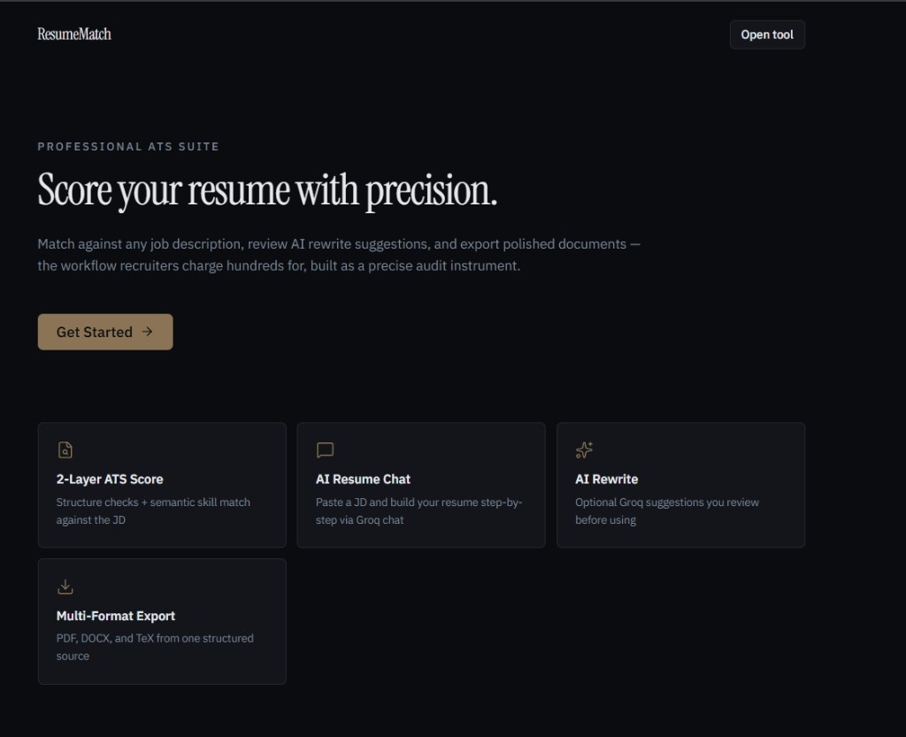
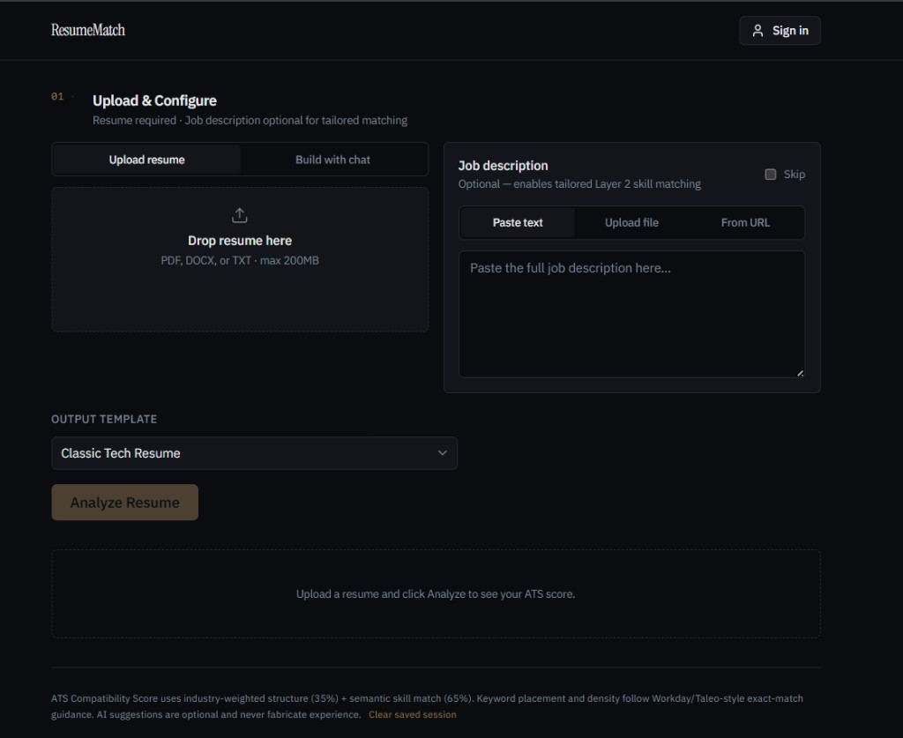
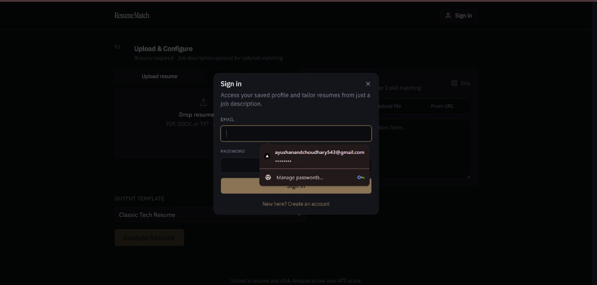
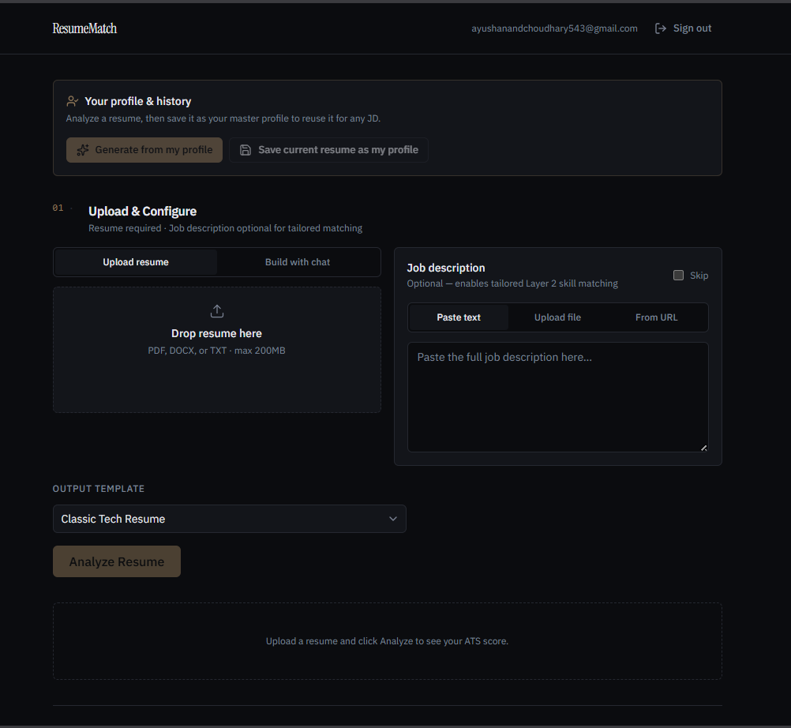
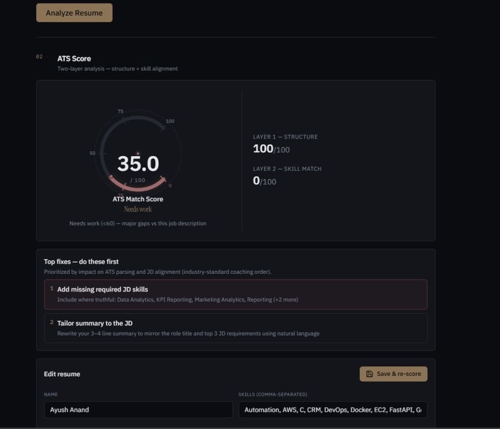
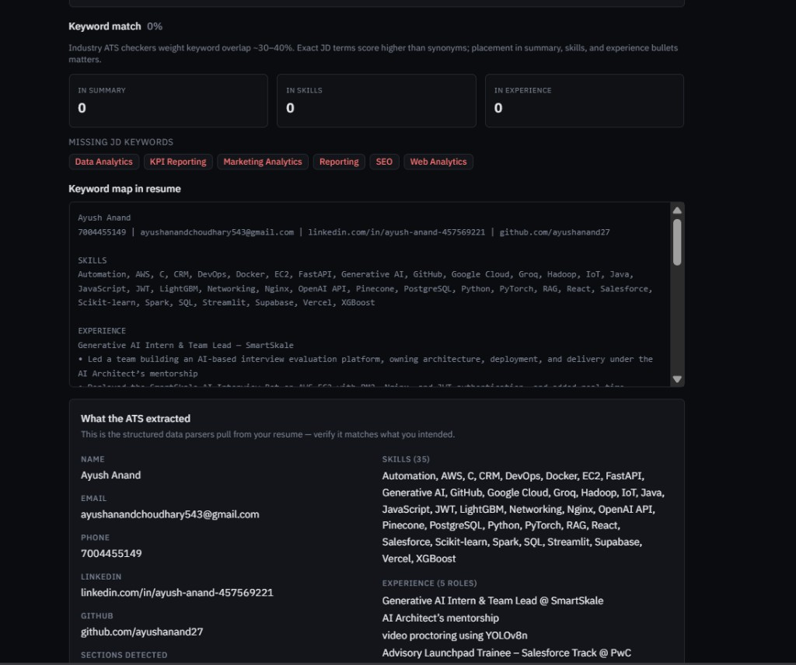
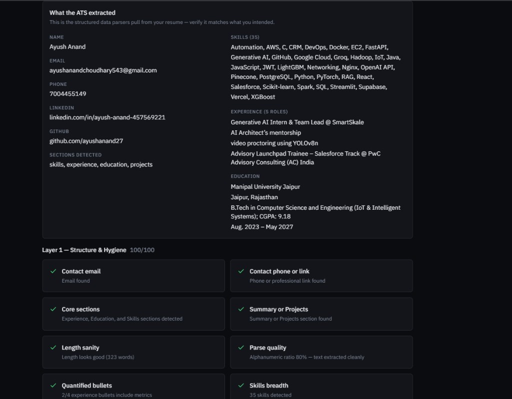
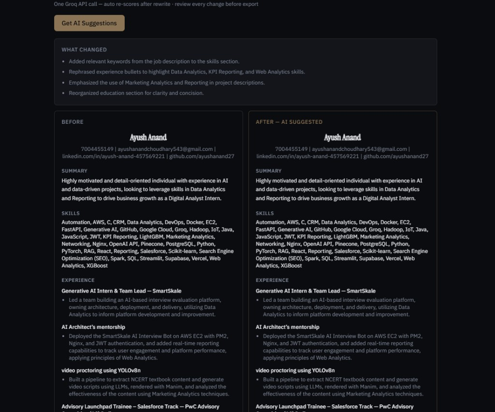
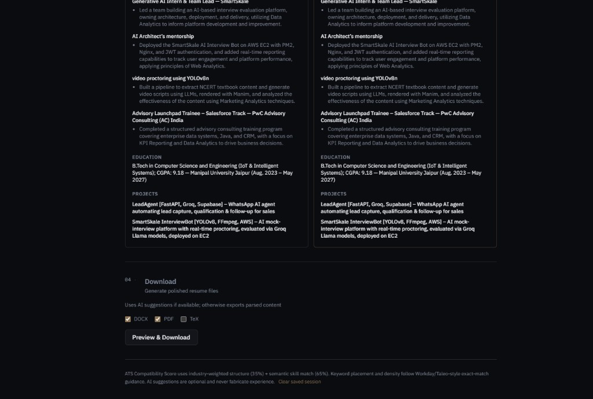

# ResumeMatch

**ATS scorer · AI rewriter · Multi-format resume generator**

ResumeMatch scores how well a resume matches a job description using industry-weighted ATS checks (keyword placement, formatting parseability, semantic skill match), suggests AI-rewritten improvements, and generates downloadable resumes in **PDF**, **DOCX**, or **LaTeX**.

> Core ATS scoring is **fully deterministic** (zero API calls for scoring). AI rewrite and resume-builder chat are **optional** Groq features. Document rendering is **100% template-based**.

## What's new in v2 (Oct 2026)

v2 came out of an audit of v1 on 1,759 publicly labelled resume–JD pairs ([dataset](https://huggingface.co/datasets/cnamuangtoun/resume-job-description-fit)). The audit showed that pasting the JD's skill list into any resume pushed the v1 score from 38 to 87.

| Change | Why |
|---|---|
| **Evidence-weighted skills** (`scoring/evidence.py`) | A skill used in a bullet earns full credit. A skill that is only *listed* earns 50%. Pasted keyword lists and templated "Built X using Y." sentences are detected and flagged. |
| **Layer 3: contextual fit** (`scoring/contextual_match.py`) | A local BGE-small model compares the *whole* resume with the *whole* JD, reading it in chunks so nothing is truncated. It was the strongest single signal in the audit. |
| **New score formula** | With a JD: 20% structure + 40% skills + 40% context. If the JD has no recognisable skills, the score now uses structure + context. v1 silently showed the structure score instead. |
| **Smarter semantic matching** | Embedding-only matches get 75% credit. A blocklist removes false equivalences found in the audit (CSS≠HTML, Unit≠Performance Testing, "Machine Learning" does not prove "Deep Learning"). |
| **JD requirement checks** (`scoring/requirements_check.py`) | Exact job title, degree level, years of experience, and acronyms written in both forms. These are the searchability checks commercial scanners run. |
| **Writing quality** (`scoring/content_quality.py`) | Action verbs, weak duty phrases ("responsible for"), first-person pronouns, clichés, bullet length. |
| **Parser fixes** (`parser.py`) | Word bullets exported to PDF as Symbol-font glyphs (U+F0B7) and DOCX list paragraphs are now detected, and wrapped bullet lines are re-joined. Before this, most Word-made resumes showed zero bullets. |
| **Bigger skill vocabulary** | 36 new taxonomy skills and 25 new alias groups (React/React.js, Postgres, GenAI, DSA, …). |
| **Safer auth default** | No more public fallback JWT secret: a random secret is generated once and stored next to the local DB. |
| **Tests + evaluation** | `pytest` suite (17 tests, offline, about 3 s) and `scripts/evaluate_dataset.py` to reproduce the numbers below. |
| **One-click run** | `setup_windows.bat` / `start_windows.bat` (and `setup.sh` / `start.sh`), plus demo files in `demo/`. |

**Measured on the 1,759-pair public test set** (`docs/eval_results_v2.json`):

| Metric | v1 | v2 |
|---|---|---|
| ROC-AUC, fit vs. no fit (all pairs) | 0.542 | **0.610** |
| ROC-AUC within the same JD | 0.626 | **0.699** |
| Ranking: MRR, true resume vs. 9 others | 0.443 | **0.490** |
| Ranking: Hit@1 | 0.243 | **0.292** |
| Avg. score of a No-Fit resume after pasting the JD skill list | 37.7 → 86.8 | 39.8 → **56.4** |
| Stuffed No-Fit resumes reaching the median Good-Fit score | 100% | **84%** |

The ranking metrics use expected values under random tie-breaking, because keyword scores tie often. Labels come from a public dataset of unknown provenance, so treat the absolute numbers as indicative.

---

## Run it on Windows in two clicks

1. Install **Python 3.12** and **Node.js LTS** once, if you don't have them:
   `winget install -e --id Python.Python.3.12` and `winget install -e --id OpenJS.NodeJS.LTS`
2. Double-click **`setup_windows.bat`**. It runs once and takes about 10 minutes. It creates the venv, installs CPU-only PyTorch and the backend packages, downloads the two local models, runs the tests, and builds the frontend.
3. Double-click **`start_windows.bat`**. It opens the API and web app windows, warms up the models, and opens http://localhost:3000/analyze.

To try it, upload `demo/resume_strong_riya.pdf`, paste `demo/jd_data_analyst.txt`, and click **Analyze**. Then do the same with `demo/resume_stuffed_aman.pdf`. Both resumes list the same skills and score the same on plain keyword matching, but v2 rates them 84 vs 42 and flags the pasted keyword list.

macOS/Linux: `./setup.sh` once, then `./start.sh`.

**Primary UI:** Next.js app in `frontend/` (`npm run dev` → http://localhost:3000/analyze). Legacy Streamlit UI remains in `resume_scorer/app.py`.

---

## Screenshots

**Landing → Analyze workflow**



| Upload & Configure | Sign in |
|:---:|:---:|
|  |  |

| Signed-in profile & history | ATS score (2-layer) |
|:---:|:---:|
|  |  |

| Keyword map & gaps | Parsed ATS view |
|:---:|:---:|
|  |  |

| AI rewrite (before / after) | Multi-format export |
|:---:|:---:|
|  |  |

> All screenshots from a live local run at http://localhost:3000/analyze. See `docs/README.md` for the full file list.

---

## Features

- **Three-layer ATS scoring (v2)** — structure (20%) + evidence-weighted skill match (40%) + contextual fit (40%); keyword placement in summary/skills/experience; stuffing detection
- **Skill evidence check** — each JD skill is shown as *demonstrated* (used in a bullet) or *listed only*, with its credit
- **JD requirement checks** — job title, degree level, years of experience, acronyms in both forms
- **Writing quality** — action verbs, weak phrases, pronouns, clichés, bullet length
- **Keyword highlight map** — see which JD terms appear in your resume text (exact + synonym at 0.8 weight, Workday/Taleo-style)
- **Parsed ATS view** — how an ATS likely reads your sections, contact, and skills
- **Formatting compatibility** — single-column, tables, headers/footers, file-type checks
- **Instant re-score** — inline editor and AI rewrite both re-run the full score pipeline with before/after delta
- **JD input** — paste, upload, or fetch from a public job URL
- **Resume builder chat** — Groq-guided interview tailored to the JD (~20–30 questions)
- **User accounts + master profile** — sign in, save your resume once, then generate a tailored resume from just a JD (auto re-scored)
- **Analysis history** — each tailoring run is saved per user and reloadable
- **LLM observability** — optional Langfuse tracing of every Groq rewrite/chat call
- **OCR for scanned PDFs** — optional recovery when native text extraction fails (requires Tesseract binary)
- **Multi-format export** — PDF (WeasyPrint), DOCX, LaTeX from **Classic Tech** or **Classic Non-Tech** templates (+ custom DOCX)
- **Browser session save** — last analysis restored from localStorage

---

## Quick start (Next.js + API)

```bash
git clone https://github.com/ayushanand27/ats-checker.git
cd ats-checker

# Terminal 1 — API
cd resume_scorer
python -m venv .venv
.venv\Scripts\activate          # Windows
# source .venv/bin/activate     # macOS/Linux
pip install -r requirements.txt
cp .env.example .env            # optional: GROQ_API_KEY for AI chat + rewrite

python -m uvicorn api.main:app --port 8000

# Terminal 2 — Frontend
cd frontend
npm install
echo NEXT_PUBLIC_API_URL=http://localhost:8000 > .env.local
npm run dev
```

Open [http://localhost:3000/analyze](http://localhost:3000/analyze).

> **API docs:** interactive Swagger UI is auto-generated at [http://localhost:8000/docs](http://localhost:8000/docs) (ReDoc at `/redoc`).

> **First run** downloads `all-MiniLM-L6-v2` (~90 MB). Core scoring works offline after that.

### Optional: OCR for scanned PDFs

Install [Tesseract](https://github.com/tesseract-ocr/tesseract) on your system. `pytesseract` is already in `requirements.txt`.

---

## Quick start (Streamlit — legacy)

```bash
cd resume_scorer
streamlit run app.py
```

Open [http://localhost:8501](http://localhost:8501).

---

## Architecture

Content generation and document rendering are **fully separated** — the same pattern used by production resume tools (Enhancv, Wobo, AIHawk):

```
┌─────────────┐     ┌──────────────┐     ┌─────────────────┐
│ Resume/JD   │────▶│ Parser +     │────▶│ Layer 1 + 2     │
│ Upload      │     │ Structurer   │     │ ATS Score       │
└─────────────┘     │ (regex/rules)│     │ (deterministic) │
                    └──────────────┘     └────────┬────────┘
                                                  │
                    ┌──────────────┐              │ gaps
                    │ Renderers    │◀─────────────┤
                    │ PDF/DOCX/TeX │     ┌────────▼────────┐
                    │ (Jinja2)     │     │ Groq LLM        │
                    └──────────────┘     │ (1 call, opt-in)│
                           ▲             │ → JSON only     │
                           └─────────────┴─────────────────┘
```

| Layer | Module | API calls |
|-------|--------|-----------|
| Input parsing | `parser.py` | **Zero** |
| Structure extraction | `structurer.py` | **Zero** |
| Layer 1 — hygiene + formatting | `scoring/deterministic.py`, `formatting.py` | **Zero** |
| Keyword analysis | `scoring/keyword_analysis.py` | **Zero** |
| Layer 2 — skill match | `scoring/semantic_match.py`, `evidence.py` | **Zero** (local `all-MiniLM-L6-v2`) |
| Layer 3 — contextual fit | `scoring/contextual_match.py` | **Zero** (local `BAAI/bge-small-en-v1.5`) |
| Requirement + writing checks | `scoring/requirements_check.py`, `content_quality.py` | **Zero** |
| AI rewriter | `insights/llm_rewriter.py` | **One** (opt-in button) |
| Accounts / profiles / history | `api/db.py`, `api/auth.py`, `api/routes/{auth,profile}.py` | **Zero** (local SQLite + JWT) |
| LLM tracing | `insights/tracing.py` | **Zero** (async to Langfuse, opt-in) |
| PDF / DOCX / TeX | `renderers/` | **Zero** |

**Score weights (v2):** With a JD → Structure 20% + Skill match 40% + Contextual fit 40%. JD with no recognisable skills → Structure 40% + Context 60%. Without a JD → structure only (general ATS check). If the contextual model is disabled (`SKIP_CONTEXT=1`) the v1 formula (35/65) is used.

### User accounts & JD tailoring

Sign in on `/analyze`, then:

1. **Save current resume as my profile** — stores a reusable master profile (SQLite).
2. **Generate from my profile** — paste any JD and get an AI-tailored, re-scored resume in one click.
3. **History** — every tailoring run is saved and reloadable per user.

Auth is self-contained: **PBKDF2** password hashing + **JWT** sessions, no external service. Set `JWT_SECRET` and a persistent `RESUMEMATCH_DB` path in production.

> ⚠️ **Security:** `JWT_SECRET` uses a hard-coded development fallback if unset. This is fine for local use, but **any deployment (even internal) must set a long, random `JWT_SECRET`** — otherwise session tokens are forgeable. Generate one with `python -c "import secrets; print(secrets.token_urlsafe(48))"` and keep it out of version control.

### LLM observability (Langfuse)

When `LANGFUSE_PUBLIC_KEY` / `LANGFUSE_SECRET_KEY` are set, Groq calls emit traces:

| Trace | When |
|-------|------|
| `resume_rewrite` | AI rewrite + Generate from profile |
| `resume_chat_turn` | Each resume-builder chat turn |

If keys are unset, tracing is a **no-op** — the app runs normally. Verify the connection with `python scripts/langfuse_smoke.py`.

---

## Docker

> **Note:** This deployment guide targets the legacy Streamlit UI. The primary Next.js + FastAPI stack is currently run locally only (see [Quick start](#quick-start-nextjs--api) above); containerized deployment for it is planned.

WeasyPrint's Pango/Cairo dependencies are pre-installed in the Dockerfile — no manual `apt-get` on the host.

```bash
cd resume_scorer
cp .env.example .env          # add GROQ_API_KEY if using AI suggestions
docker build -t resumematch .
docker run -d -p 8501:8501 --env-file .env --name resumematch resumematch
```

Visit `http://localhost:8501` (Streamlit). For production, deploy the FastAPI service (`uvicorn api.main:app`) + Next.js static export or Vercel — see `render.yaml`.

---

## AWS EC2 deployment

> **Note:** Like the Docker section above, this targets the legacy Streamlit UI. The Next.js + FastAPI stack currently runs locally only; a containerized deploy path for it is planned.

Same Docker pattern as SmartSkale InterviewBot:

1. Launch a **t2.micro** / **t3.micro** Ubuntu instance (free tier).
2. Security group — allow inbound **TCP 8501** (or **80** with Nginx reverse proxy).
3. Install Docker:
   ```bash
   sudo apt-get update && sudo apt-get install -y docker.io
   sudo usermod -aG docker $USER
   # log out and back in
   ```
4. Clone and configure:
   ```bash
   git clone https://github.com/ayushanand27/ats-checker.git
   cd ats-checker/resume_scorer
   cp .env.example .env && nano .env   # set GROQ_API_KEY
   ```
5. Build and run:
   ```bash
   docker build -t resumematch .
   docker run -d -p 8501:8501 --env-file .env --restart unless-stopped resumematch
   ```

Access at `http://<EC2-public-ip>:8501`.

---

## Usage flow

1. **Upload** a resume or **build with chat** (JD required for chat) — paste/upload/fetch JD
2. Click **Analyze** → ATS score with keyword map, parsed view, and top fixes
3. **Edit inline** or click **Get AI Suggestions** (Groq) — both auto **re-score** with before/after delta
4. Review keyword highlights, formatting checks, and change log
5. **Preview & Download** → PDF, DOCX, and/or `.tex`

---

## Project structure

```
ats-checker/
├── setup_windows.bat / start_windows.bat   # one-click local run
├── demo/                           # demo JD + two demo resumes
├── docs/eval_results_v2.json       # evaluation numbers
├── frontend/                       # Next.js 14 UI (primary)
│   └── app/analyze/page.tsx
└── resume_scorer/
    ├── api/                        # FastAPI
    │   ├── main.py                 # app + router wiring + DB init
    │   ├── db.py                   # SQLite (users, profiles, analyses)
    │   ├── auth.py                 # PBKDF2 hashing + JWT
    │   └── routes/                 # analyze, chat, rewrite, generate, auth, profile
    ├── app.py                      # Legacy Streamlit UI
    ├── parser.py                   # PDF/DOCX/TXT + optional OCR
    ├── structurer.py
    ├── scoring/
    │   ├── deterministic.py
    │   ├── semantic_match.py       # Layer 2 (exact/alias/embedding + evidence)
    │   ├── evidence.py             # evidence-weighted credit + stuffing detection
    │   ├── contextual_match.py     # Layer 3 (BGE-small, chunked)
    │   ├── requirements_check.py   # title / degree / experience / acronyms
    │   ├── content_quality.py      # writing-quality checks
    │   ├── keyword_analysis.py
    │   ├── formatting.py
    │   └── fix_suggestions.py
    ├── insights/
    │   ├── llm_rewriter.py
    │   ├── resume_chat.py
    │   └── tracing.py              # Langfuse (optional, no-op if unset)
    ├── tests/                      # pytest suite (offline, stub models)
    ├── scripts/
    │   ├── evaluate_dataset.py     # v1 vs v2 on the public labelled dataset
    │   ├── langfuse_smoke.py       # verify Langfuse connection
    │   └── test_auth_profile.py    # auth + profile + tailor + history test
    ├── templates/
    │   ├── jacks_tech/             # Classic Tech Resume
    │   └── classic_nontech/
    └── renderers/
```

---

## Environment variables

| Variable | Required | Description |
|----------|----------|-------------|
| `GROQ_API_KEY` | No | Enables AI rewrite, chat, and JD tailoring. Get one at [console.groq.com](https://console.groq.com). |
| `JWT_SECRET` | Prod | Signs user session tokens. Use a long random string in production (locally a random secret is generated once and kept in `resume_scorer/data/`). |
| `RESUMEMATCH_DB` | No | Path to the SQLite DB for accounts/profiles/history. Point to a persistent volume in production. |
| `LANGFUSE_PUBLIC_KEY` | No | Enables LLM tracing. From [cloud.langfuse.com](https://cloud.langfuse.com) → Settings → API Keys. |
| `LANGFUSE_SECRET_KEY` | No | Langfuse secret key (pairs with the public key). |
| `LANGFUSE_BASE_URL` | No | Langfuse host, e.g. `https://cloud.langfuse.com`. |
| `CORS_ORIGINS` | No | Comma-separated origins allowed to call the API (e.g. your Vercel URL). |
| `SKIP_LAYER2` | No | Set to `1` on low-memory hosts to skip Layer 2 embeddings. |
| `SKIP_CONTEXT` | No | Set to `1` to skip the Layer 3 contextual model (saves ~130 MB RAM). |
| `CONTEXT_MODEL` | No | Override the contextual model (default `BAAI/bge-small-en-v1.5`). |
| `EVIDENCE_LIST_CREDIT` | No | Credit for skills that are only listed, 0–1 (default `0.5`; `0` = listed skills earn nothing). |
| `TESSERACT_CMD` | No | Path to `tesseract.exe` if not on PATH (Windows auto-detects Program Files). |

Copy `resume_scorer/.env.example` to `.env` and fill in your keys. Core ATS scoring works without any of them.

---

## Testing

Unit and API tests run offline with a stub embedding model (about 3 seconds):

```bash
cd resume_scorer
pip install -r requirements-dev.txt
python -m pytest -q
```

Reproduce the v1-vs-v2 evaluation (about 10 minutes on CPU):

```bash
curl -L -o test.csv https://huggingface.co/datasets/cnamuangtoun/resume-job-description-fit/resolve/main/test.csv
python scripts/evaluate_dataset.py --csv test.csv --out eval_results.json
```

An end-to-end script exercises signup → login → save profile → JD tailoring → history against a running API:

```bash
cd resume_scorer
.venv\Scripts\activate                 # Windows (or source .venv/bin/activate)
python -m uvicorn api.main:app --port 8000   # in one terminal

python scripts/test_auth_profile.py    # in another
```

Verify the Langfuse connection separately with `python scripts/langfuse_smoke.py`.

---

## Tech stack

- **Next.js 14** + **TypeScript** + **Tailwind** (primary UI)
- **FastAPI** + **Python 3.10–3.13**
- **PyMuPDF** / **python-docx** / optional **pytesseract** (input parsing)
- **sentence-transformers** (`all-MiniLM-L6-v2` for skills, `BAAI/bge-small-en-v1.5` for contextual fit) — local semantic matching
- **Groq** (`llama-3.3-70b-versatile`) — optional chat + rewrite
- **Jinja2** + **WeasyPrint** (PDF) + **python-docx** (DOCX) + **LaTeX templates**

---

## v1 scope & limitations

| Included | Not in v1 |
|----------|-----------|
| Next.js UI + FastAPI | Cloud DB (uses local SQLite) |
| User accounts + saved master profile | Server-side `pdflatex` compile |
| JD auto-tailoring + per-user history | Multi-platform ATS profiles (Workday vs Greenhouse) |
| PDF, DOCX, TeX export | Payment / batch processing |
| Classic Tech + Non-Tech templates | LinkedIn-protected URL scraping |
| Custom DOCX template upload | Email verification / password reset |
| JD paste, upload, URL fetch | |
| Keyword placement + density analysis | |
| OCR for scanned PDFs (with Tesseract) | |
| Inline editor + auto re-score | |
| Resume builder chat | |
| Langfuse LLM tracing | |
| Browser session persistence | |

TeX output is **source only** — compile locally or upload to [Overleaf](https://www.overleaf.com).

---

## Disclaimer

ATS Compatibility Score is fully deterministic, based on parsing and keyword-matching approaches similar to real ATS systems. AI rewrite suggestions are optional, reviewed by you before use, and the AI is instructed never to fabricate experience or metrics. This tool is independent and not affiliated with any company's actual ATS system.

---

## License

MIT License — see [LICENSE](LICENSE).
